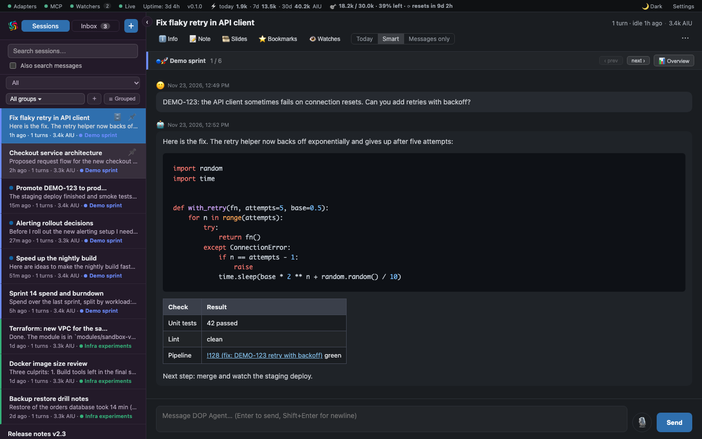
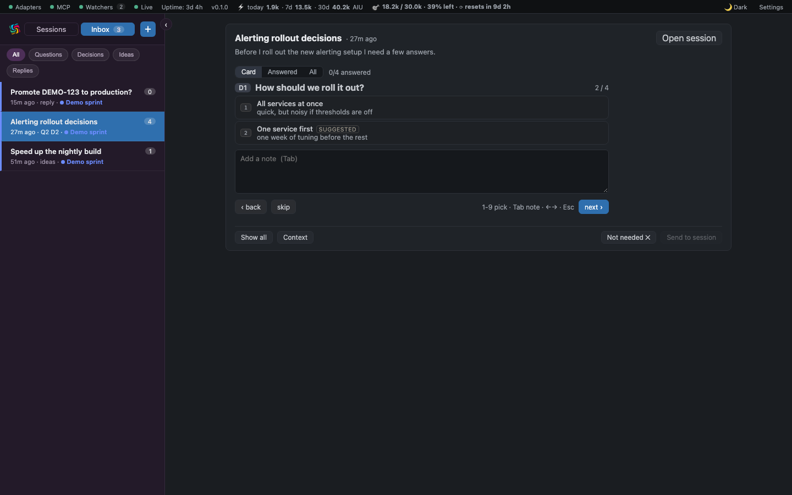
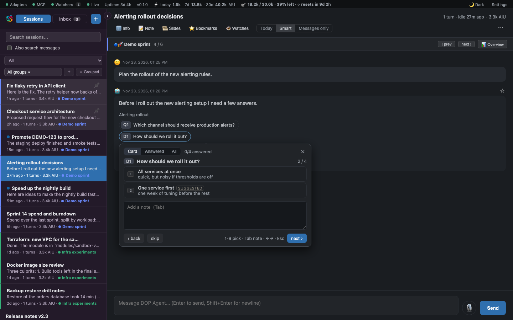
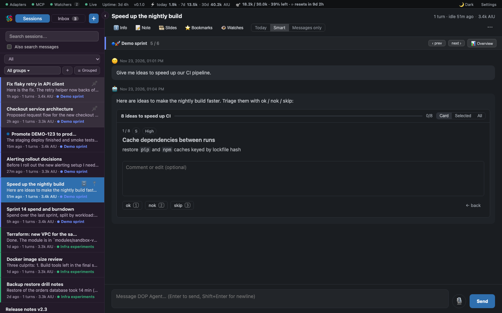
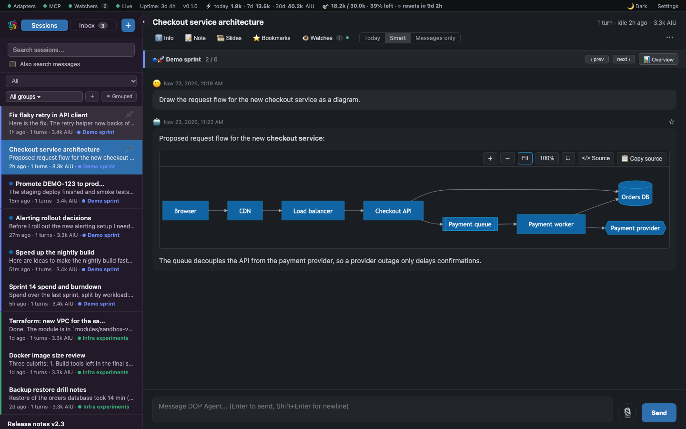
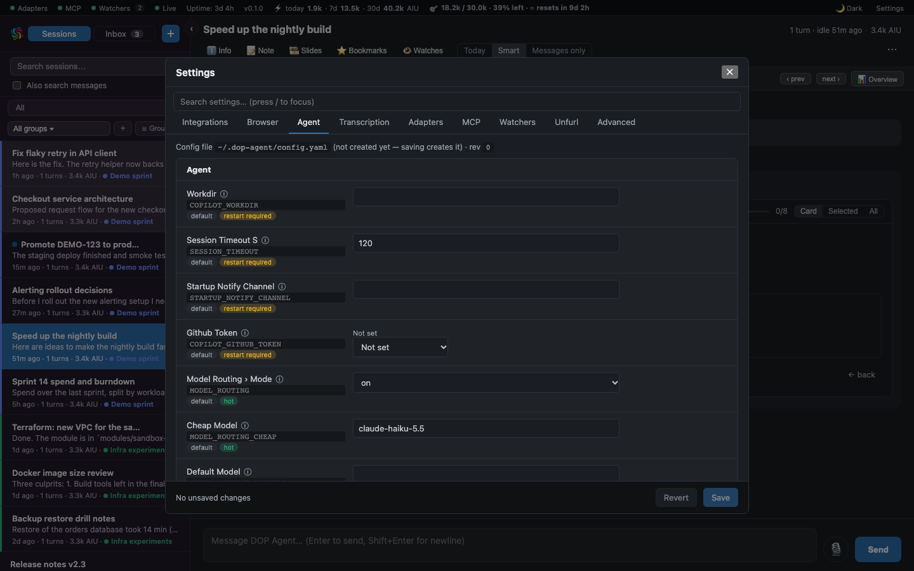

# DOP Agent

A personal, always-on agent that bridges **Slack**, **Telegram** and a local **Web UI** to
**GitHub Copilot CLI running in autopilot mode**. Send a message from your phone or browser, get a
full Copilot agent turn back — with persistent sessions, watchers ("ping me when this PR/pipeline/ticket
changes"), voice transcription, an inbox of open questions, and a catalogue of optional integrations
(GitHub, GitLab, Jira, Confluence, Grafana, Prometheus, Terraform, ...).



> **Unofficial project.** DOP Agent is not affiliated with, endorsed by or sponsored by GitHub,
> Microsoft, Slack, Telegram or any other vendor named here. A **GitHub Copilot subscription is required**.
> Read [Security model and warnings](#security-model-and-warnings) before running it.

## Screenshots

| | |
|---|---|
|  Inbox of unanswered questions |  Clickable `ask` blocks |
|  ok/nok/skip `ideas` triage |  Mermaid diagrams |
|  Settings and integrations | |

## Requirements

- Python 3.12+ (e.g. `brew install python@3.13` on macOS, or your distro's package)
- [GitHub Copilot CLI](https://docs.github.com/copilot/concepts/agents/about-copilot-cli) (`copilot --version`; needs Node.js) and an active Copilot subscription
- A GitHub token with Copilot access (`COPILOT_GITHUB_TOKEN`)
- Optional native libs for table/Markdown-to-PNG rendering and voice transcription: Cairo/Pango (WeasyPrint), `ffmpeg` (Whisper)
- macOS (launchd), Linux (systemd user unit) or Docker

## 5-minute quickstart (Web UI only)

```bash
git clone https://github.com/devopspass/dop-agent.git && cd dop-agent
python3 -m venv .venv && . .venv/bin/activate
pip install -r requirements.txt
cp .env.example .env
```

Edit `.env` (no Slack/Telegram needed):

```env
COPILOT_GITHUB_TOKEN=github_pat_...         # token with Copilot access
COPILOT_WORKDIR=/absolute/path/to/workdir   # folder the agent operates in
WEB_UI_PASSWORD=choose-a-long-password      # required for the Web UI
```

```bash
python3 -u dop_agent.py
```

Open <http://localhost:10818>, log in with the password and start a session. Slack and Telegram are
optional add-ons: see [docs/slack-setup.md](docs/slack-setup.md) and
[docs/telegram-setup.md](docs/telegram-setup.md).

## Install as a service

| Platform | How |
|---|---|
| macOS (launchd) | `./bot_ctl.sh install && ./bot_ctl.sh start` — creates `~/Library/LaunchAgents/com.dop-agent.plist` for this checkout. Details: [docs/installation.md](docs/installation.md) |
| Linux (systemd user unit) | Edit paths in `scripts/dop-agent.service`, copy it to `~/.config/systemd/user/`, then `systemctl --user daemon-reload && systemctl --user enable --now dop-agent` |
| Docker | `docker compose up -d` using `Dockerfile` and `docker-compose.yml` (mount `~/.dop-agent` and your work directory; the Web UI is published on `127.0.0.1` only) |

macOS examples use Homebrew (`brew install cairo pango gdk-pixbuf libffi ffmpeg`); on Linux install the
same libraries with your package manager.

## Configuration

Settings come from, in order of precedence: environment variables, `.env`, `~/.dop-agent/config.yaml`
(see [`config.example.yaml`](config.example.yaml); keep it `chmod 600`), built-in defaults. Most of it
can also be edited in the Web UI under **Settings**.

Secrets are never written inline in the YAML; use references:

| Reference | Resolves to |
|---|---|
| `${env:NAME}` | environment variable |
| `${file:~/path}` | contents of a file (must be `chmod 600`) |
| `${keychain:service}` | macOS Keychain item |

Key variables: `COPILOT_GITHUB_TOKEN`, `COPILOT_WORKDIR`, `SESSION_TIMEOUT`, `WEB_UI_HOST`/`WEB_UI_PORT`/
`WEB_UI_PASSWORD`, `SLACK_BOT_TOKEN`/`SLACK_APP_TOKEN`/`ALLOWED_USER_ID`, `TELEGRAM_BOT_TOKEN`/
`TELEGRAM_ALLOWED_USER_IDS`, `TABLE_RENDER_MODE`, `WHISPER_MODEL`. See `.env.example` for all of them.

## Architecture

```
Slack (Socket Mode) · Telegram (long polling) · Web UI / API (FastAPI)
                    ↕
        adapters.py + handlers.py / web_server.py
                    ↕
   bot_store.db (conversations + bindings + transcript)
                    ↕
   CopilotConversation / GitHub Copilot Python SDK
                    ↕
              Copilot CLI → GitHub Copilot API
```

- One Copilot session per conversation UUID; a conversation can be bound to a Slack thread, a Telegram topic and the Web UI at once.
- Sessions survive restarts (resumed from the stored session id; lost final answers are recovered from the Copilot event log).
- Outbound-only transports: no public URL or inbound port is needed.

Full description: [docs/architecture.md](docs/architecture.md).

### Module map

| File | Purpose |
|---|---|
| `dop_agent.py` | Entry point: wiring, crash-recovery resume, `main()` |
| `handlers.py` | Slack handlers and the core turn-processing engine |
| `adapters.py` | Channel-adapter abstraction (Slack, Web, Telegram) and the broadcaster |
| `telegram_*.py` | Optional Telegram adapter |
| `web_server.py`, `webui/` | FastAPI Web UI/API/MCP server and static frontend |
| `copilot_session.py` | Per-conversation Copilot session registry |
| `crash_recovery.py`, `persistence.py` | Restart safety, session-id persistence |
| `message_store.py` | SQLite data layer (`bot_store.db`) |
| `watchers.py`, `watch_scripts.py`, `scripts/watch/` | Background watchers, token-free script watches |
| `model_routing.py` | Per-session model routing and AIU estimation |
| `usage_index.py` | Token/AIU usage widget index |
| `transcription.py`, `audio_store.py` | Whisper voice transcription and audio retention |
| `render_tables.py`, `render_markdown.py`, `slack_formatting.py` | Output rendering and formatting |
| `config.py`, `bot_config.py`, `settings_api.py` | Config loading, env handling, Settings API |
| `drivers/`, `integrations/` | Integration drivers and their registry/runtime |
| `mcp_tools.py` | In-process MCP server mounted at `/mcp` |
| `groups.py`, `message_kinds.py` | Session groups, Smart-view message classifier |
| `skills/` | Skills bundled with the agent (`ask-format`, `actions-format`, `ideas-format`, `chart-format`, `four-phase-plan`, ...) |
| `tests/` | Offline unit tests |

## Drivers and integrations

Drivers are optional, **off by default**, and configured per instance in Settings or `config.yaml`.
Each enabled instance exposes a CLI and a skill to the agent, link cards and watcher recipes.

| Area | Drivers |
|---|---|
| Source & CI | GitHub, GitLab, Bitbucket, Jenkins, Argo CD, Kargo, Artifactory |
| Work tracking & docs | Jira Cloud, Jira Service Management, Confluence Cloud, ServiceNow, ServiceNow CMDB |
| Observability & ops | Grafana, Prometheus/Alertmanager, Datadog, Splunk, PagerDuty/Opsgenie, Wiz |
| Infrastructure | Terraform (HCP/Enterprise), HashiCorp Vault |
| Chat | Slack workspace |
| **EXPERIMENTAL** | Microsoft Teams, Microsoft Outlook, SharePoint/OneDrive, Power BI |

> **EXPERIMENTAL — Microsoft drivers (`ms_teams`, `ms_outlook`, `ms_sharepoint`, `powerbi`).**
> They drive a signed-in browser session over the Chrome DevTools Protocol and rely on internal,
> undocumented web endpoints. They can break without notice and **may violate Microsoft's terms of
> service** for your tenant or account. Use at your own risk, only with accounts you are allowed to
> automate, and prefer official APIs where available.

Adding a driver: a folder `drivers/<id>/` with `driver.yaml`, `cli/`, optional `watch/`, a skill
template and `icon.svg` (user drivers can live in `~/.dop-agent/drivers/`). See [docs/development.md](docs/development.md).

## Usage

Talk to it from the Web UI, a Slack DM/@mention or Telegram. Highlights: persistent sessions, session
groups, watchers on PRs/pipelines/tickets/time ([docs/watchers.md](docs/watchers.md)), live progress,
model routing, voice messages ([docs/transcription.md](docs/transcription.md)), table/Markdown rendering
([docs/rendering.md](docs/rendering.md)), and an in-process MCP server at `/mcp`. More in
[docs/usage.md](docs/usage.md) and [docs/web-ui.md](docs/web-ui.md).

## Security model and warnings

**Read this before you run it.**

- **The agent runs with your privileges.** Autopilot with `approve_all` (the equivalent of `copilot --yolo`) auto-approves every file and shell tool call. Anyone who can talk to the agent can run commands as your user, and the agent can use every credential reachable from that user.
- **Prompt injection.** The agent reads text from Jira, GitLab, GitHub, Slack, web pages and files. Malicious content in any of them can try to steer it into running commands or leaking data. Run it as a dedicated least-privilege user or in Docker, give integrations read-only tokens where possible, and prefer the confirm-first write commands drivers provide.
- **Web UI is localhost-only with a mandatory password.** It binds to loopback by default and must not be exposed to a LAN or the internet without a reverse proxy providing real authentication and TLS. Login attempts are rate-limited per IP.
- **Chat access is allow-listed.** Only the configured Slack and Telegram user ids may interact; an empty allow-list denies everyone.
- **Token handling.** Keep secrets in env vars, `chmod 600` files or the macOS Keychain and reference them with `${env:}`/`${file:}`/`${keychain:}`; drivers do not print them.
- **Local data.** State lives in `~/.dop-agent` (SQLite stores, audio, caches) with `0600` permissions; conversation transcripts are stored unencrypted. Back up and wipe accordingly.
- **No telemetry.** Nothing is sent anywhere except to the services you configure (GitHub Copilot, Slack, Telegram, integrations). Whisper weights are downloaded once on first use.
- **PyMuPDF (AGPL-3.0)** is an *optional* extra, not installed by default. Install it only if the AGPL terms are acceptable to you.

Details and vulnerability reporting: [SECURITY.md](SECURITY.md), [docs/security-details.md](docs/security-details.md).

## Development

```bash
pip install -r requirements.txt
python3 -m pytest tests -q    # unit tests run offline
```

See [CONTRIBUTING.md](CONTRIBUTING.md), [docs/development.md](docs/development.md) and
[docs/RELEASING.md](docs/RELEASING.md). Version history: [CHANGELOG.md](CHANGELOG.md).

## Documentation

| Topic | Page |
|---|---|
| Architecture | [docs/architecture.md](docs/architecture.md) |
| Installation & daemon | [docs/installation.md](docs/installation.md) |
| Slack setup | [docs/slack-setup.md](docs/slack-setup.md) |
| Telegram | [docs/telegram-setup.md](docs/telegram-setup.md), [docs/telegram-architecture.md](docs/telegram-architecture.md) |
| Web UI | [docs/web-ui.md](docs/web-ui.md) |
| Usage | [docs/usage.md](docs/usage.md) |
| Watchers | [docs/watchers.md](docs/watchers.md) |
| Session groups | [docs/session-groups.md](docs/session-groups.md) |
| Rendering | [docs/rendering.md](docs/rendering.md) |
| Voice transcription | [docs/transcription.md](docs/transcription.md) |
| Security notes | [docs/security-details.md](docs/security-details.md) |
| Development | [docs/development.md](docs/development.md) |

## License

Apache License 2.0 — see [LICENSE](LICENSE) and [NOTICE](NOTICE). Dependencies keep their own
licenses (notably PyMuPDF: AGPL-3.0, optional).

## Trademarks

GitHub, GitHub Copilot, Microsoft, Teams, Outlook, SharePoint, Power BI, Slack, Telegram, Jira,
Atlassian and all other product names are trademarks of their respective owners. They are used for
identification only and imply no affiliation or endorsement.
