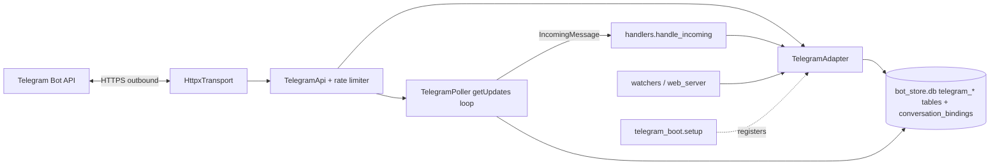
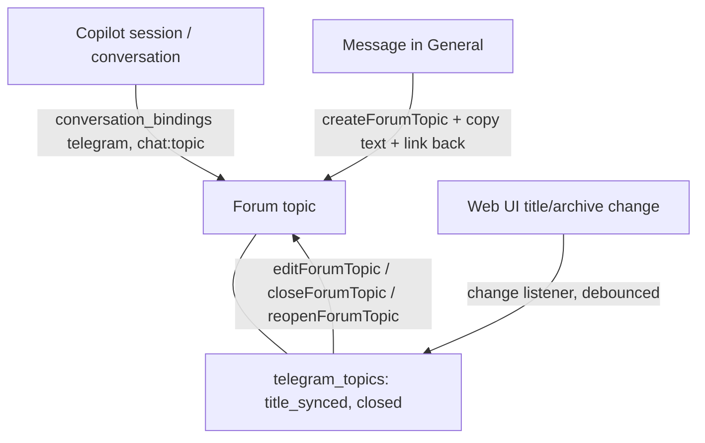

# Telegram adapter - how it works

Optional third chat surface next to Slack and the Web UI. It is a pure transport: all agent logic stays in `handlers.py`; Telegram only sends/edits/uploads messages and feeds inbound updates in as `IncomingMessage`. Setup: [telegram-setup.md](telegram-setup.md).

## Design rules

- **Long polling only** (`getUpdates`, outbound HTTPS). No webhook, no inbound port; `deleteWebhook` runs at start.
- **Off by default.** Active only with `TELEGRAM_BOT_TOKEN` (or `_FILE`) **and** a non-empty `TELEGRAM_ALLOWED_USER_IDS` (fail closed), and `adapters.telegram.enabled` true.
- **Never breaks Slack/Web.** Setup errors and poller crashes are logged and swallowed. Config is read lazily (never at import).
- **One HTTP seam.** All Bot API calls go through `TelegramTransport`; tests inject `tests/fakes/fake_telegram.py`.

## Components

| Module | Role |
|---|---|
| `telegram_config.py` | Lazy config getters, token (env or mode-600 file). |
| `telegram_api.py` | `TelegramTransport` protocol, `HttpxTransport`, typed `TelegramApi`, `ChatRateLimiter`, `TelegramError`, token redaction, httpx loggers forced to WARNING. |
| `telegram_format.py` | Markdown to Telegram HTML, fence-aware splitting (4000 UTF-16 budget), HTML validation, `actions`/`ask`/`ideas` fence handling. |
| `telegram_adapter.py` | `TelegramAdapter` (`platform="telegram"`): send/update/delete/upload/reactions, topic lifecycle, title/archive sync. |
| `telegram_poller.py` | `TelegramPoller`: update loop, auth, commands, General redirect, media download, callbacks. |
| `telegram_store.py` | sqlite state in `bot_store.db`. |
| `telegram_boot.py` | `setup()` (register adapter) and `start_poller()`, called from `dop_agent.main`. |

## Startup order

1. `telegram_boot.setup()` runs **before** `web_server.init` and crash recovery, so interrupted Telegram turns can be resumed (recovery looks the adapter up in the registry).
2. Crash recovery runs.
3. `start_poller()` fires the loop: `getMe` -> `deleteWebhook` -> self-check (is it a forum? Manage Topics right?) -> poll forever.

## Inbound flow

1. `getUpdates(timeout=50, allowed_updates=[message, edited_message, callback_query, my_chat_member])`.
2. The new offset is **persisted before dispatch** (at-most-once; a restart never replays old messages into an autopilot agent).
3. Dropped: edited messages, updates older than `TELEGRAM_MAX_UPDATE_AGE` (600 s), senders not in the allow-list or chats other than the forum chat / allowed private chats (silent, no API call; callbacks from strangers are still answered to clear the spinner).
4. Commands `/start /help /new /stop` are handled in the poller and never reach the agent.
5. Text/media become `IncomingMessage(ref="chat:msgid")` and are run as a fire-and-forget task, so polling never blocks on a long turn. `handlers.handle_incoming` then does auth, dedup, binding lookup and the turn.
6. Photos/documents (<= 20 MB) are saved to `~/.dop-agent/telegram_files/` and passed as `[Attachment: path]`; voice goes through `transcription.py`.

A 409 (second poller or leftover webhook) backs off 5-60 s; a 401/404 stops the poller with a clear log line.

## Session mapping (per-session view)

- **Forum mode** (`TELEGRAM_FORUM_CHAT_ID`): one topic per session. Binding key `"<chat_id>:<topic_id>"` in `conversation_bindings` (the only session mapping). `ensure_topic` binds *before* the first send.
- **Title/archive sync:** a listener on `message_store` changes diffs title/archived against `telegram_topics` and schedules `editForumTopic` / `closeForumTopic` / `reopenForumTopic` on the bot loop (thread-safe, debounced).
- **Recovery:** a deleted topic ("thread not found") is recreated and rebound; sending into a closed topic reopens it.
- **General topic:** a message there creates a new topic, copies the text, replies with a link, then runs the turn in the new topic.
- **DM mode** (no forum chat): one active session per chat, key `"<chat_id>"`; `/new` starts slot `"<chat_id>:<n>"`; replying to a bot message routes to that message's session (`telegram_msgmap`).
- **New Web UI sessions** get a topic only with `NEW_SESSION_PLATFORM=telegram`. Web/Slack sessions are otherwise not mirrored automatically.

## Outbound / rendering

- `format_markdown` returns plain-markdown chunks (fence-aware); conversion to HTML happens at send time. Slack shortcodes map to unicode, tables become `<pre>`, links are scheme-checked.
- Parse error from Telegram -> one retry as plain text. "message is not modified" is treated as success.
- Status message is edited (throttled, 3 s in groups / 1.5 s in DMs) with a Stop button; the final answer is a new message so the push notification fires. Edits with no buttons keep the existing keyboard.
- Fences: `actions` and single-select `ask` become inline buttons; `ideas`, `chart`, `mermaid` degrade to text.
- Reactions use only Telegram's allowed emoji set (one reaction per message).
- Uploads: `sendPhoto` (falls back to `sendDocument` for big/odd-shaped images), albums for 2-10 files, <= 50 MB.
- Rate limiting: per-chat token bucket (~1 msg/s, 18/min in groups). 429 `retry_after` is honoured for sends (capped) and dropped for status edits.

## Callbacks

`callback_data` is limited to 64 bytes. Stop uses stateless `st:<conversation uuid>`; other buttons use short tokens `ab:<token>` stored in `telegram_callbacks` (survive restarts; an unknown/expired token shows "expired"). Every callback is answered; double taps are deduplicated; the sender is checked against the allow-list.

## State (`bot_store.db`)

| Table | Content |
|---|---|
| `telegram_kv` | `update_offset`, `dm_slot:<chat>` |
| `telegram_topics` | `(chat_id, thread_id) -> conversation_id`, `title_synced`, `closed` |
| `telegram_msgmap` | bot message -> binding key (DM reply routing) |
| `telegram_callbacks` | short callback tokens -> text/action |
| `allowed_identities` (platform `telegram`) | seeded from env at startup; ids removed from env are revoked |

## Security

- Allow-list of numeric user ids, checked on `from.id` for messages **and** callbacks; empty list = adapter does not start (autopilot agent behind it).
- Token only via env or mode-600 file; redacted in errors; httpx loggers at WARNING so the token-bearing URL never reaches the log.
- Keep the group private; only add trusted members (members who are not allow-listed are ignored anyway).

## Known limitations

- User edits of sent messages are ignored; generic Slack-style `bt:` buttons are unsupported.
- Rapid messages in one topic are dispatched concurrently (no strict ordering); two different General messages create two topics.

## Tests

`tests/telegram/` (API, format, adapter, poller, integration) + the shared `tests/adapter_contract/` run via `make_telegram()`. Run: `cd dop-agent && python3 -m pytest tests/telegram tests/adapter_contract -q`.
